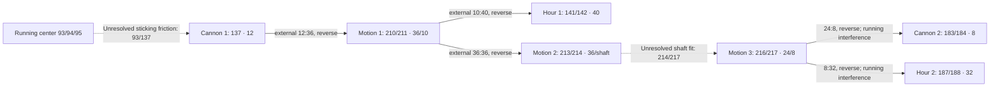

# Motion-work running review — 27 October 2026

**28 October implementation follow-up:** [four front/transfer packets now move](FRONT_DISPLAY_ANIMATION.md)
under the user's explicit 93/137 sticking assumption. The 214/217 boundary is
an incomplete illustration, with no physical slip claim. Rear packets and all
phases remain unchanged. The research below is historical; its source-fit,
sampled/continuous and physical-acceptance limitations remain.


Follow-up: [the independent component/fit investigation](FRICTION_CONNECTIONS.md)
confirms both mating geometries against separate maker STEP files and refines
the friction evidence boundary. It supports an intended 1:1 normal-running
interpretation without finding an explicit maker joint-state constraint. The
running-clearance findings below and unchanged application decision still apply.
The subsequent [reverse-mesh diagnosis](REVERSE_MESH_DIAGNOSIS.md) separates
source/display phases from runtime transforms and evaluates isolated phase
alternatives. It does not install those alternatives or overturn the failures
at the existing phases documented here.

**No additional packet is enabled.** The seven requested candidates contain 13
source leaves. The three front-side gear interfaces clear the conditional running
sweep, but that does not establish a driven front train. The center/cannon friction
connection is not specified by the source, the cross-face shaft fit is not a
source-declared rigid connection, and **both reverse-face meshes penetrate during
ratio-coupled motion at the unchanged display phases**. There is no independently
supported portion to enable without introducing an assumed inlet or disconnect.

The existing prescribed escapement and train through barrel II continue running.
This is a verified investigation milestone, **not a completed motion-work animation**.
The [provenance](../assets/source-manifest/motion-works-study.json) records source
identities, conditional ratios, exact measurements, code hashes and local evidence.
The original [running movement](RUNNING_MOVEMENT.md), [train study](TRAIN_COUPLING_STUDY.md)
and source-fit limitations remain applicable. No geometry or phase was changed.

## Source identity and exact packets

Baseline: clean `073a870` on `codex/escapement-clearance-study`, after the balance
smoothing revert. Original STEP SHA-256:
`f34148903818c273e20deeb0e70d3dc7782e08a413bc0e420f30d8c209aa4a2b`.
The maker URL is retained in [sources.json](../assets/source-manifest/sources.json).
The probe reads the original XCAF assembly, resolves every leaf occurrence chain,
and recomposes its world matrix. All scoped matrices match the catalog to the
1e−10 check threshold. For each multi-leaf candidate, the definition's direct
XCAF component references exactly match the two listed children. `vernietet`
(riveted) in the source assembly names supports their internal rigid membership.
Cannon pinion 1 is **one leaf**, not a multi-leaf assembly. No neighboring screw,
jewel, hand bushing or coaxial packet is added to it.

Occurrence suffixes below append to
`p_0_1_1_1__0_1_1_1_4__0_1_1_83_`. Full occurrence IDs, STEP paths and matrices
are in the provenance. All axes are parallel to world Z. The local-Z column gives
each listed leaf's direction in world coordinates. XY pivots are nominal mm;
full-precision source matrices remain authoritative.

**Every ratio and period in this table is conditional, not installed.** Let `E`
be the unchanged accumulated escape angle and `C = −E/540` the running center
angle. Assume, only for the diagnostic calculation, sticking at both nonmeshing
shaft interfaces. Periods use the existing +54°/s mean escape rate at 3 Hz.

| Packet | Definitions; exact occurrence suffixes | Teeth | Axis XY; local Z signs | Angle/C | Angle/E | Mean revolution period |
| --- | --- | --- | --- | ---: | ---: | ---: |
| Cannon pinion 1 | 137: `20` | 12 | (0,0); + | +1 | −1/540 | 1 h |
| Motion works 1 | 210,211: `55__0_1_1_209_1`, `55__0_1_1_209_2` | 36 / 10 | (4.24287382474019,0.2460116); +,− | −1/3 | +1/1620 | 3 h |
| Hour wheel 1 | 141,142: `26__0_1_1_140_1`, `26__0_1_1_140_2` | 40; hub | (0,0); +,+ | +1/12 | −1/6480 | 12 h |
| Motion works 2 | 213,214: `56__0_1_1_212_1`, `56__0_1_1_212_2` | 36; shaft | (0,5); +,− | +1/3 | −1/1620 | 3 h |
| Motion works 3 | 216,217: `57__0_1_1_215_1`, `57__0_1_1_215_2` | 24 / 8 | (0,5); +,− | +1/3 | −1/1620 | 3 h |
| Cannon pinion 2 | 183,184: `37__0_1_1_182_1`, `37__0_1_1_182_2` | 8; shaft | (0,7.4); −,− | −1 | +1/540 | 1 h |
| Hour wheel 2 | 187,188: `40__0_1_1_186_1`, `40__0_1_1_186_2` | 32; hub | (0,7.4); −,− | −1/12 | +1/6480 | 12 h |

The named tooth counts are independently corroborated by counting disjoint tooth
lobes outside each nominal pitch circle in the original solid sections. All ten
toothed leaves agree. This verifies count, not tooth profile manufacture or
loaded conjugacy. Source-declared modules are 0.177 (137/210/213), 0.17 (211/141),
0.15 (183/216), and 0.12 (217/187).

## Complete conditional connection and evidence boundary



External meshes reverse world-Z direction: `θb = −Na/Nb × θa`. Thus 137→210
contributes −1/3, 211→141 contributes −1/4, 210→213 contributes −1, 216→183
contributes −3, and 217→187 contributes −1/4. The shared internal wheel/pinion
rotations follow the source's riveted packets. No coaxial hour wheel is attached
to its cannon pinion, and the seconds shaft remains separate from the center.

The two nonmeshing connections require more evidence:

- **93→137:** center shaft d93 faces 79/83 and cannon bore d137 face 63 have
  matching 0.375 mm radii. The bore extends approximately world Z −1.44…+0.33 mm;
  the shaft has cylindrical seating lands and an intervening reduced circular
  waist. Original solids have nominal contact (distance <1e−15 mm), zero common
  volume, and no inspected keyed section. d94 is 1.25 mm away from d137; d95 is
  0.097779 mm away. The supported observation is a nominal round shaft/bore fit,
  consistent with a cannon friction interface. It is **not** an encoded rigid
  mate or a source-specified sticking condition. The CAD does not establish
  clamping/lanterning, preload, slip torque or the normal-running constraint.
- **214→217:** motion works 2 and 3 are separate XCAF assemblies. d214's lower
  round taper overlaps the 0.13 mm radius bore of d217: source common volume
  **0.007245609 mm³**. Measured shaft radii are about 0.141474…0.144359 mm at
  Z −5.50…−5.05 mm. Circular sections have no key. d214 clears d216 by
  **0.251085 mm**; the candidate joining surface is d217's bore, not wheel 216.
  This supports an interference/friction-fit interpretation, but does not prove
  whether it is a permanent press fit, an adjustable friction joint or a
  simplified source fit. A 1:1 normal-running link is conditional. Arbitrarily
  letting it slip to keep the rear still would be another unsupported assumption.

The general cannon-pinion friction function is described by component maker
[Joray & Wyss](https://www.joray-wyss.ch/en/assemblage). That supports terminology,
**not an ML-01-specific constraint**; no general watchmaking description is used
to certify these source fits. Winding and hand-setting interactions are excluded.
No crown position, clutch engagement, setting torque or setting-wheel motion is
inferred. The unresolved sticking/setting behavior is recorded at these interfaces
rather than replaced with an unconditional rigid packet.

## Running geometry at unchanged phases

The existing train tools were reused, with a configurable subdivision count and
an additional worst-overlap solid witness. At 192 subdivisions per tooth event,
each pair traverses its **complete material orientation repeat**, including its
closing configuration; this does not assume identical teeth. There are **32,261
source-section configurations** and separately **32,261 runtime-section
configurations**. The periods span 3 h, 12 h, 3 h, 3 h and 12 h respectively under
the conditional rates. The sweep covers all phases traversed by recoil as well
as the net advance; it does not solve contact/backlash during that recoil.

| Pair | Section Z mm | Configurations | Minimum sampled source gap mm | Continuous polygon gap lower bound mm | Selected whole-solid result |
| --- | ---: | ---: | ---: | ---: | --- |
| 137/210 | −1.30 | 6,913 | 0.012210352 | 0.008920802 | 15 poses clear; min gap 0.012201424 mm |
| 211/141 | −0.82 | 7,681 | 0.015039221 | 0.011836883 | 15 poses clear; min gap 0.015028437 mm |
| 210/213 | −1.30 | 6,913 | 0.005045698 | 0.001941985 | 15 poses clear; min gap 0.005040003 mm |
| 183/216 | −5.20 | 4,609 | 0 | no positive bound | 16 poses; max common **0.000062792 mm³** |
| 217/187 | −5.48 | 6,145 | 0 | no positive bound | 16 poses; max common **0.000001882 mm³** |

Source profiles use 0.00002 mm chord sampling. As in the earlier train study,
conservative interaction-window clipping caps the gap at 0.05 mm, and a rigid
point-displacement bound is subtracted to cover times between samples. The
positive bounds apply to **these planar polygons only**, not continuous 3D
solids, source tolerances or manufactured parts. Whole-solid common and distance
checks at 77 selected poses corroborate the pass/fail findings; they are not a
continuous swept-solid certificate. Tiny polygon artifacts at coincident
shaft/bore boundaries are not treated as solid penetration; original BRep results
remain the fit evidence.

The reverse failures are not merely insufficient sampling bounds: d183/d216 has
**2,736** intersecting source-section configurations (maximum area 0.000313034
mm²); d217/d187 has **1,216** (maximum 0.000009178 mm²). Their selected original
whole-solid positive volumes independently establish penetration. No new phase,
axis shift, tooth reshaping or smoothing is proposed to hide it. This does not
establish a maker manufacturing defect or prove no other design/phase could work.

## Actual runtime transforms and neighboring parts

The Node diagnostic loads the actual Meshopt-decoded overview. Only inside that
isolated diagnostic process, it supplies the seven hypothetical packets to the
production `RunningMovement` controller. Nothing is added to app metadata.
Production `movementPose` is evaluated at positive active times reaching the
selected accumulated escape phases; ratios are applied before final modulo.
`shaftMatrix` left-multiplies each unchanged authored display matrix, correctly
handling reversed local axes. The selected controller matrices agree exactly
with the exported matrices (maximum error **0**).

Runtime triangle sections traverse the same full periods. The three front pairs
have sampled minimum gaps **0.012654372**, **0.015251254**, and **0.005496200 mm**.
The reverse pairs have **2,568** and **544** intersecting configurations. Selected
whole-triangle BVH checks intersect in **5/16** and **2/16** poses respectively;
the 45 selected front poses do not intersect. These runtime results are sampled,
not new continuous bounds. Source and runtime sections are deliberately retained
separately; tessellation changes the tiny overlap areas and is not used to erase
the original-solid findings.

Neighbor treatment is explicit:

- All 13 candidate leaves receive conservative full-turn BRep boxes against all
  other original source leaves. The local inventory records every bounded
  exclusion, invalid/missing/non-solid exception and remaining candidate. This is
  a box screen against frozen source-display neighbors, **not a passed neighbor
  sweep**. The report stops short of exhaustive neighboring-solid qualification
  because the train already fails its own meshes.
- Holding motion works 2 still while motion works 1 rotates produces a selected
  **0.042683544 mm³** d210/d213 solid common. Holding motion works 1 still while
  cannon 1 rotates produces **0.033062982 mm³** d137/d210 common. The other three
  frozen-follower boundaries likewise penetrate. A clear front-side conditional
  sweep therefore cannot justify independently moving a front packet against a
  frozen meshed dependent packet.
- Original source-fit overlaps, invalid d27/d111, open-shell d144 and the empty
  source diamond remain unqualified by this study. Fitted hand variants, all-phase
  moving neighbors and deforming-spring interactions would need further checks
  before any future candidate acceptance. No new continuous-neighbor or tolerance
  claim is made. Existing accepted motion and its earlier clearance evidence are
  unchanged.

## Local validation and next action

Local CAD calculations were essential because the source/cache is private and
this review cannot use CI without a prohibited push. The focused tests and
headless browser lifecycle review were explained before execution. Production
runtime, timing policy, motion binary, metadata and both authored phase files
match `073a870` byte for byte. No app build or broad test suite was needed for
this research-only milestone.

The nine focused movement tests pass, including a new regression that keeps all
13 blocked leaves and hand leaves static through delayed/long active time,
suspension, reassembly and disposal. The existing checks retain the 3 Hz / 21,600
beats/hour clock, balance amplitude, original escapement path/recoil, train
ratios, display phases, pause/resume, hidden-time exclusion and cleanup.
All **18 existing headless browser checks pass** on the current-source local
development server, covering Explorer, completed Workshop/Undo and assembled
Bench with the documented synthetic visibility/completion fixtures. No application
or shader errors were recorded. This is one desktop run, not device qualification. The local movement view
is left open for review. This is prescribed kinematics, not physically
self-sustaining motion. Hands, winding/setting interactions, ratchets, arbors,
barrel I, mainspring deformation and the barrel-II boundary are unchanged.

Next work requires ML-01-specific evidence establishing the normal-running
center/cannon and cross-face shaft connections, plus a separately reviewed
resolution of the two reverse running contacts within the permitted geometry
and phase policy. Until then, all seven candidates remain static. A future
proposal must recheck the complete dependent graph and remaining neighbors; the
front section passes alone are insufficient to enable it.

Reproduce using the retained environments/caches (not a clean-machine recipe):

```sh
OPENBLAS_NUM_THREADS=1 .venv-cad/bin/python scripts/cad/escapement-clearance/motion_works.py
OPENBLAS_NUM_THREADS=1 .venv-cad/bin/python scripts/cad/escapement-clearance/motion_works_interfaces.py
OPENBLAS_NUM_THREADS=1 .venv-cad/bin/python scripts/cad/escapement-clearance/motion_works_sweep.py periods
OPENBLAS_NUM_THREADS=1 .venv-cad/bin/python scripts/cad/escapement-clearance/motion_works_sweep.py solids
OPENBLAS_NUM_THREADS=1 .venv-cad/bin/python scripts/cad/escapement-clearance/motion_works_boundaries.py
node scripts/movement/review-motion-works.mjs
OPENBLAS_NUM_THREADS=1 .venv-cad/bin/python scripts/cad/escapement-clearance/motion_works_runtime.py
node --test tests/running-movement.test.mjs
# Existing local server, Playwright and Chrome paths as in RUNNING_MOVEMENT.md:
MOVEMENT_EVIDENCE_ROOT=artifacts/motion-works/browser node scripts/movement/browser-check.mjs http://127.0.0.1:4173
python3 scripts/cad/escapement-clearance/record_motion_works.py
```

Derived meshes, BReps, logs and screenshots stay in ignored `artifacts/motion-works/`.
No push, PR, merge, deploy, publish or redistribution. Existing release gates remain.
